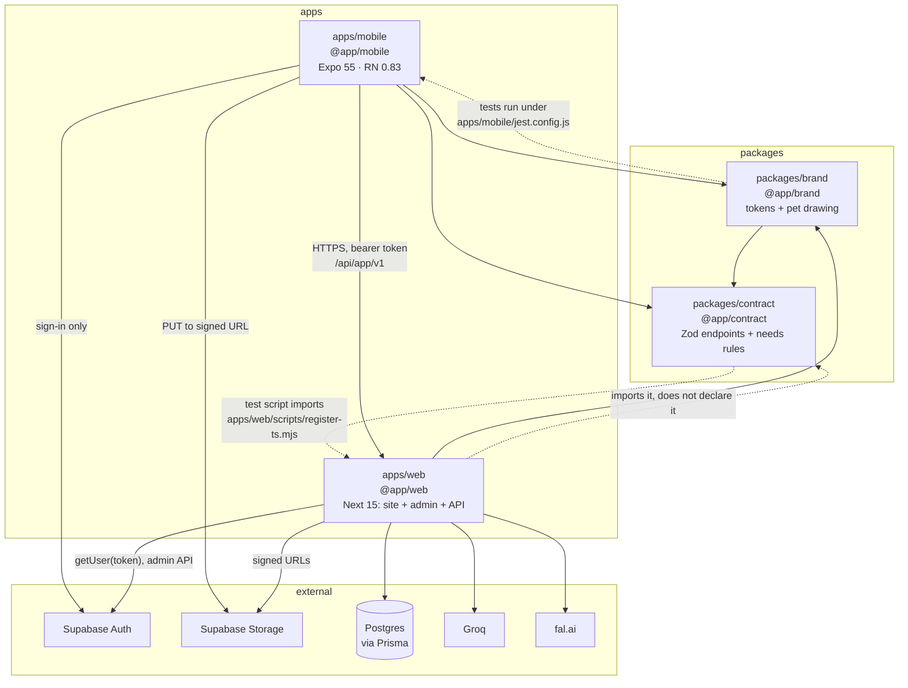

# Architecture review: Kinpaw monorepo

Reviewed 2026-10-09 on branch `feat/v3-pet-looks`. The review started at `1b5ec95` with the
Welcome work uncommitted and ended at `452cc11`, after it was committed; what I read is that tree.
Read-only: no file was changed except this report. Every claim below cites a file; where I could
not verify something, section 7 says so.

## 1. Executive summary

**Score: 10.5 / 15.**

This is a disciplined codebase with an unproven production story. The server boundary is the best
part: one Zod contract shared by both apps, one route wrapper that cannot skip auth or validation,
Prisma stores that lock rows and scope every query by the verified caller, and a migrations
pipeline that replays, checks drift, reads the RLS catalog and runs the database suites as a
non-superuser. Typecheck, lint, 1,226 tests and every `check:*` gate pass locally. Against that:
nothing has ever been deployed, so the release path (Vercel, hosted Supabase, EAS, the migration
deploy workflow) is configuration nobody has run; there is no rate limiting anywhere; the money
webhook trusts an unvalidated, unordered payload; the dependency tree carries 75 open advisories
with no gate watching it; and the app has no end-to-end test and treats offline as a wall. The
score sits at the low end of "solid with real gaps" because the gaps are concentrated exactly where
a hackathon build meets real users.

No finding is rated Critical today, because nothing is deployed and RevenueCat is unconfigured.
ARCH-01, ARCH-02 and ARCH-03 become Critical the day the web app takes public traffic.

**Top 3 risks**

1. **Unpatched dependencies on a public endpoint, with no gate.** `sharp@0.35.4` has an open
   high-severity advisory and decodes attacker-supplied bytes on the unauthenticated photo route.
   `npm audit` reports 75 advisories; CI never runs it and there is no Dependabot or Renovate
   (ARCH-01).
2. **The entitlement webhook is not safe against real delivery.** No schema, no event id, no
   ordering: a late `EXPIRATION` after a `RENEWAL` sets a paying customer to `free` (ARCH-02).
3. **No abuse controls.** No rate limit on any route; the waitlist enrols any address with
   `marketing_consent: true`; the paid photo reader is limited by values the caller chooses
   (ARCH-03, ARCH-04).

**Top 3 strengths**

1. **The contract.** `packages/contract` defines every `/api/app/v1` endpoint once; the server
   validates input and output with it (`apps/web/src/server/api/app-route.ts:50-77`) and the app
   validates what it sends and parses what it receives (`apps/mobile/lib/api.ts:216-260`). The
   needs rules live there too, so optimistic updates and the server run the same function.
2. **Database change control.** CI replays every migration on empty Postgres, fails on drift,
   reads RLS and grants from the catalog, and runs the stores as a non-superuser role
   (`.github/workflows/ci.yml:119-211`, `scripts/check-rls.mjs`,
   `apps/web/src/server/db/runtime-role.test.mts`).
3. **Type and boundary discipline that is enforced, not aspirational.** Zero `any`, zero
   `@ts-ignore` in source; ESLint bans the Supabase SDK, Prisma client, Pino and `process.env`
   outside their one owning file (`eslint.config.mjs:41-86`, `:202-261`).

## 2. Scorecard

| #   | Category                        | Score    | Max      | Justification                                                                                                      |
| --- | ------------------------------- | -------- | -------- | ------------------------------------------------------------------------------------------------------------------ |
| 1   | Monorepo structure & boundaries | 1.5      | 2.0      | Clean graph, no cross-app or deep imports; an undeclared dependency, inverted test scripts, unused base tsconfig   |
| 2   | Shared packages & reuse         | 1.0      | 1.5      | The contract is excellent; `brand` mixes tokens with pet-drawing domain; web copies app logic by hand              |
| 3   | Mobile app architecture         | 2.0      | 2.5      | Strong data layer, errors, session and routing; offline is a wall, tokens in AsyncStorage, grab-bag `lib/`         |
| 4   | Web (Next.js) architecture      | 0.5      | 1.0      | Correct App Router use; one deployable for four jobs, no security headers, placeholder domain and addresses        |
| 5   | Backend (Supabase)              | 2.0      | 2.5      | Top-tier migration and RLS tooling; stringly-typed columns, unordered webhook, process-local state                 |
| 6   | Type safety & contracts         | 1.0      | 1.5      | Strict, no `any`, Zod both ways; `noUncheckedIndexedAccess` off in both apps, six routes without a schema          |
| 7   | Testing                         | 1.0      | 1.5      | 1,226 passing tests with real database suites; no E2E, 1 of 28 screens rendered, no coverage measurement           |
| 8   | Tooling, CI/CD & DX             | 0.5      | 1.0      | Many good gates; one serial job, no audit, no dependency bot, no mobile bundle check, release path never exercised |
| 9   | Security & secrets              | 0.5      | 1.0      | No secret in the repo, fail-closed guards; no rate limiting, consent abuse, open advisories, committed transcripts |
| 10  | Documentation & agent context   | 0.5      | 0.5      | Unusually thorough and mostly accurate; the drift in section 8 is real but small                                   |
|     | **Total**                       | **10.5** | **15.0** |                                                                                                                    |

## 3. Architecture overview

### What the repository actually is

The brief describes `apps/web` as a marketing site and `supabase/` as the backend with RLS
policies and edge functions. The code is different, and the difference shapes every score:

- **`apps/web` is the backend.** It holds the marketing site, the admin panel, the mobile API
  (`/api/app/v1`, 18 route files), the Play Stats API, a cron route, the RevenueCat webhook and
  all AI provider calls (`apps/web/src/server/{talk,photo,voice}`).
- **Supabase is identity and file storage only.** No table is read through PostgREST. Every table
  has RLS enabled with no policies and nothing granted to `anon` or `authenticated`
  (`scripts/check-rls.mjs:42-71`); Prisma connects as the table owner. There are no edge
  functions. `supabase/migrations/` is frozen history, disabled in
  `supabase/config.toml:32-33`.
- **The schema is Prisma's**: 10 `.prisma` files, 29 migrations under
  `apps/web/prisma/schema/migrations/`.

### Stack, as found

| Area         | What is in use                                                                                                                       |
| ------------ | ------------------------------------------------------------------------------------------------------------------------------------ |
| Workspace    | npm workspaces (`apps/*`, `packages/*`), one lockfile, Node 22 pinned in `.nvmrc`, `legacy-peer-deps=true`, no build orchestrator    |
| Mobile       | Expo SDK 55, React Native 0.83.10, React 19.2.0, Continuous Native Generation (no `ios/` in git), development builds, not Expo Go    |
| Navigation   | expo-router with `Stack.Protected` groups decided once in `apps/mobile/app/_layout.tsx:400-418`                                      |
| Server state | TanStack Query 5, `networkMode: 'always'`, custom retry (`apps/mobile/lib/queryClient.ts:20-30`)                                     |
| Client state | React context only: theme, toast, pet draft, subscription. No global store                                                           |
| Styling      | NativeWind 4 plus themed `StyleSheet` factories, tokens from `@app/brand`                                                            |
| Validation   | Zod 4 on both sides via `@app/contract`; no form library                                                                             |
| Web          | Next.js 15.5.26 App Router, React 19, Tailwind 3, Server Components by default (35 of 87 `.tsx` files are client)                    |
| Data         | Prisma 6.19 on Postgres 17, stores in `apps/web/src/server/db/`                                                                      |
| Supabase     | Auth (email OTP; Apple and Google disabled locally), Storage (one private bucket, signed URLs). Realtime and edge runtime on, unused |
| AI           | Groq (talk, intro, memory), fal.ai (photo, voice), each behind a provider interface with a stub                                      |
| Unconfigured | RevenueCat, Sentry, PostHog, EAS, Vercel, hosted Supabase                                                                            |

tsconfig inheritance: `tsconfig.base.json` is extended only by `packages/brand` and
`packages/contract`. `apps/mobile/tsconfig.json` extends `expo/tsconfig.base`;
`apps/web/tsconfig.json` extends nothing.

### Dependency graph



Solid arrows are runtime dependencies. The dotted arrows are the three boundary defects in
ARCH-11. There are no cycles at runtime, no app imports the other, and no file reaches into a
package's `src/`.

## 4. Detailed category reviews

### 4.1 Monorepo structure & boundaries: 1.5 / 2.0

**Strengths**

- No cross-app imports and no deep imports into package internals (grep for `@app/*/src`,
  `../../packages`, `apps/` in import specifiers: zero hits).
- One copy of `react`, `react-native` and `zod` in the tree; React is pinned to `19.2.0` in both
  apps. The only version drift is `eslint` (`^9.39.4` root, `^9.17.0` in `apps/web`).
- `apps/mobile/metro.config.js:17-24` handles hoisting correctly: watches the monorepo root and
  resolves from both `node_modules` trees.
- One ESLint flat config scopes each framework's rules to its workspace
  (`eslint.config.mjs:94-120`), which avoids the duplicate-plugin failure this layout usually
  hits.

**Weaknesses**

- `apps/web/package.json:27` declares `@app/brand` but not `@app/contract`, which 96 files in
  `apps/web/src` import. It resolves only because npm hoists the workspace link.
- Packages depend on apps to run their own tests: `packages/contract/package.json:13` imports
  `../../apps/web/scripts/register-ts.mjs`; `packages/brand/package.json:16` runs under
  `../../apps/mobile/jest.config.js`.
- `tsconfig.base.json` is not the base of either app, so its strictest flags apply to 5,400
  lines of package code and none of the roughly 47,000 lines of app code.
- `.npmrc` sets `legacy-peer-deps=true`, which silences every peer-dependency conflict in a
  React Native tree, where peer ranges are the main compatibility signal.
- `@app/brand` depends on `@app/contract` because the pet drawing needs appearance types. A
  design-token package now pulls in the API contract.

**Is Turborepo or Nx needed?** Not yet. Four workspaces and a full local gate run in a few
minutes. The cost shows up in CI instead (ARCH-14): add task caching when CI time, not workspace
count, becomes the constraint.

### 4.2 Shared packages & reuse: 1.0 / 1.5

**Strengths**

- `@app/contract` is genuinely shared: 107 mobile files and 96 web files import it. Its
  `endpoints` map (`packages/contract/src/v1/endpoints.ts`) drives both the server wrapper and
  the client, so a route's method, path, auth mode and schemas have one definition.
- Shared business rules, not only shapes: `decayNeeds`, `applyAction`, `moodFor` are used by
  `apps/mobile/hooks/usePetAction.ts:33-36` and `apps/web/src/server/db/pets.ts`.
- Both packages expose a narrow `exports` map and ship 148 tests between them.

**Weaknesses**

- `@app/brand` is two packages in one: tokens, palettes and Tailwind presets, plus 857 lines of
  pet-drawing domain (`src/pet.ts`, `src/petDrawing.ts`, `src/petZones.ts`).
- `@app/contract` is drifting from "wire schemas" to "domain core": `appearance.ts` (575 lines,
  the catalog) and `memory.ts` (550 lines, including scoring) are not contracts.
- The website copies app logic by hand. `apps/web/src/lib/sky.ts:16-26` re-implements `phaseAt`
  and `schemeForPhase` from `apps/mobile/lib/sky.ts`; `apps/web/src/lib/pet-lines.ts:11-18`
  says its lines are "copied from where the app keeps it" and must be re-copied when they
  change. Nothing checks that they still match.
- No shared test or TypeScript config package, which is why ARCH-11's inverted scripts exist.

### 4.3 Mobile app architecture: 2.0 / 2.5

**Strengths**

- **Data layer.** `apps/mobile/lib/api.ts` is a typed client over the contract: it validates the
  request, attaches the token, retries once on 401 after a refresh, distinguishes `offline`,
  `unreachable`, `timeout`, `invalid_response` and `cancelled`, and never returns a partial
  result. Screens get data or an `ApiError` with a message written for the person.
- **Session handling.** A 503 is never read as signed out (`apps/mobile/lib/supabase.ts:81-98`);
  concurrent 401s sign out once (`lib/api.ts:149-159`); sign-out clears the query cache,
  notifications and pending deep links (`app/_layout.tsx:274-284`).
- **Routing.** One place decides where a person belongs, and a failed pet load at launch shows a
  retry instead of guessing (`app/_layout.tsx:350-366`).
- **Optimistic mutations done carefully.** `hooks/usePetAction.ts` serialises taps with a
  mutation scope and writes back only the last in-flight answer.
- **Env and OTA.** Static `EXPO_PUBLIC_*` reads in one file with ESLint enforcement
  (`lib/env.ts:83-93`); the fingerprint config hashes `eas.json` as data so a reformat cannot
  orphan an update (`fingerprint.config.js`).

**Weaknesses**

- **Offline is a wall.** No persisted query cache; a cold start without a connection shows a
  full-screen overlay (`components/OfflineOverlay.tsx`), although the needs are computed on the
  phone and the last pet could be shown (ARCH-08).
- **Session tokens in AsyncStorage** (`lib/supabase.ts:45`) while `expo-secure-store` is
  installed and used for the install id (ARCH-09).
- **Layer-based folders that have stopped scaling**: `lib/` holds 58 files of unrelated
  concerns, `components/pet/` 32. `hooks/usePetBehaviour.ts` is 745 lines and
  `app/(tabs)/index.tsx` is 525 lines calling about 20 hooks (ARCH-17).
- **Dead weight in the binary and the launch path**: `react-native-purchases-ui` has no
  importer; i18next, react-i18next and `locales/en.json` are initialised on every launch and
  gate the splash (`app/_layout.tsx:220`, `:290`) while no screen calls `t()`;
  `lib/mockData.ts` and `lib/featureFlags.ts` have no importers (ARCH-19).
- **Release configuration is still the template's**: `app.json:8` and `:145` hold `REPLACE_…`
  placeholders, the Sentry organisation is `your-org`, and the microphone purpose string says
  the app "records sound while you film a video to upload" (`app.json:102`), which it does not.
- Smaller: `SubscriptionContext.tsx:129-140` passes a new object every render; the only error
  boundary is at the root and offers no recovery (`app/_layout.tsx:77-104`); Sentry reports
  every non-dev build as `production` (`:65`).

### 4.4 Web (Next.js) architecture: 0.5 / 1.0

**Strengths**

- App Router used as intended: Server Components by default, `'use client'` at the leaves,
  admin pages `force-dynamic`, marketing pages static.
- Metadata on every public page, `sitemap.ts`, `robots.ts`, `next/font` with only the active
  display face preloaded (`src/app/layout.tsx:15-36`).
- Server actions re-check `requireAdmin()` themselves and the file says why
  (`src/app/admin/(protected)/users/actions.ts:9-12`).

**Weaknesses**

- **One deployable does four jobs** (marketing, admin, mobile API, AI backend). A copy change on
  the landing page redeploys the API the installed app depends on, and they share one scaling
  and failure domain (ARCH-13).
- **No security headers.** `next.config.mjs` defines no `headers()`: no CSP, HSTS,
  `X-Frame-Options` or `Referrer-Policy`, on an app that serves an admin panel.
- **Middleware runs on every route**, including `/api/app/v1/*`, which never uses cookies
  (`src/middleware.ts:42-45`). The matcher also lets `.mp4` and `.mp3` through.
- **Placeholders in production paths**: `SITE_URL ?? 'https://example.com'` in `layout.tsx:44`,
  `robots.ts:3`, `sitemap.ts:3`; a `www.example.com` redirect in `next.config.mjs:13-23`;
  `support@example.com`, `privacy@example.com` and `legal@example.com` on the legal pages.
- The landing page is animation-heavy for a marketing surface: 15 of 30 landing components are
  client components. I did not measure the bundle.

### 4.5 Backend: 2.0 / 2.5

**Strengths**

- **Migrations are reproducible and guarded.** Replay on empty Postgres, drift check, catalog
  RLS check, run-once SQL ledger, and a production workflow that fingerprints the baseline
  before marking it applied (`.github/workflows/deploy-migrations.yml:79-98`).
- **RLS on every table as a locked door**, verified from the catalog rather than from SQL text.
  The history shows why this matters: `20260924000200_lock_the_api_roles_out` documents that
  the original column REVOKEs were no-ops and any signed-in person could have made themselves
  admin.
- **No service-role key on a client.** The secret key is created only in
  `src/lib/supabase/secret-key.ts` behind `server-only`, and its return type removes `.from()`
  and `.rpc()`.
- **Concurrency handled in the stores**: `FOR UPDATE` on both profiles in id order before a
  friendship is created (`src/server/db/friends.ts:167-194`), a needs lock for care and talk,
  client-generated ids as idempotency keys for pets, talks and intro attempts.
- **Deletion semantics are modelled**: cascade for owned rows, `SetNull` for history that
  outlives the account.

**Weaknesses**

- **The webhook** (ARCH-02).
- **Invariants live only in application code.** `plan_type`, `premium_status`, `outcome`,
  `intent`, `category`, `kind` are free `String` columns
  (`prisma/schema/accounts.prisma:25`, `:40`); needs have no 0–100 check and friendships no
  `user_low < user_high` check ("checked by the store", `friends.prisma:20`). One writer today;
  the admin panel, run-once SQL and a future second service are all additional writers.
- **Authorization has one layer.** Prisma connects as the table owner, so RLS does not gate it.
  A store method that forgets `where: { userId }` is an IDOR with no backstop. The stores I
  read are scoped correctly; nothing mechanical enforces it.
- **Process-local state in a serverless target** (ARCH-07).
- **Local config defaults that must not reach production**: `otp_expiry = 86400` for a
  six-digit code (`supabase/config.toml:93-94`); realtime and edge runtime enabled with nothing
  using them (`:46`, `:124`).
- **No seed data.** `supabase/seed.sql` is comments only; a new developer gets an empty database
  and promotes an admin by hand. `supabase/snippets/Untitled query 278.sql` is a committed
  scratch query that does exactly that.
- **No retention on append-only tables**: `analytics_events`, `analytics_pageviews`, `ai_usage`
  and `pet_photo_reads` grow without bound.

### 4.6 Type safety & contracts: 1.0 / 1.5

**Strengths**

- `strict: true` in all four tsconfigs. Zero `any` and zero `@ts-ignore` / `@ts-expect-error`
  in application and package source; `no-explicit-any` is an ESLint error.
- Runtime validation in both directions at the app/server boundary, and on model output
  (`src/server/talk/reply-schema.ts`, `src/server/photo/answer-schema.ts`).
- Prisma types are generated on install and kept honest by the drift check; they stay on the
  server and never leak to the phone, which gets DTOs from the contract.
- Both env files have a Zod schema, and `check:env` proves code, schema and `.env.example`
  agree.

**Weaknesses**

- `noUncheckedIndexedAccess` and `noImplicitOverride` are set in `tsconfig.base.json:8-9` and
  inherited by neither app (ARCH-10).
- Six route files parse nothing with a schema: the RevenueCat webhook, `lifecycle/session`,
  `cron/lifecycle`, both Play Stats routes and `admin/users`. The webhook casts
  `(body?.event ?? {}) as RcEvent` (`route.ts:184`) (ARCH-16).
- About 100 `as` casts across both apps (46 mobile, 54 web), most of them benign narrowing; 6
  `as unknown as`.
- The web env schema validates at boot but is not the read path: 41 direct `process.env.X`
  reads and no importer of a typed `env` object.

### 4.7 Testing: 1.0 / 1.5

**Strengths**

- 1,226 tests, all passing locally: 194 script tests, 564 Jest (58 suites, mobile plus brand),
  356 web, 112 contract.
- The tests assert behaviour, not existence. `apps/mobile/__tests__/petAction.test.ts` holds
  requests open to prove ordering; the route suites parse responses with the contract and
  assert which store calls happened.
- Real database suites for every store, run in CI against Postgres 17 as a non-superuser.
- The gates are themselves tested (`scripts/*.test.mjs`, 194 tests, including a fixture copy of
  the repo that each standard is mutated against).

**Weaknesses**

- **No end-to-end test of any kind.** No Maestro, Detox or Playwright. Sign-in, create a pet,
  save, care, talk: the product's core path is never exercised as a whole (ARCH-05).
- **One of 28 screens is rendered in a test** (`__tests__/meetPet.test.tsx`). The 525-line Home
  screen has none.
- **No coverage measurement**, so "critical paths are covered" is an impression.
- **`npm test` skips the nine database suites locally** unless `TEST_DATABASE_URL` is set; a
  developer can ship a broken store and see green until CI.
- Three routes have no suite: `/api/dashboard/v1/summary` (the Play Stats API, the repo's own
  non-negotiable 2), `/api/lifecycle/session` and `/api/admin/users`.
- No web component tests and no accessibility checks beyond the brand contrast suite.

### 4.8 Tooling, CI/CD & DX: 0.5 / 1.0

**Strengths**

- Eleven gates, identical locally and in CI, plus hooks for secrets and commit messages.
- Node pinned in `.nvmrc`, `engines`, CI and every `eas.json` profile.
- Thoughtful details: the migrations job passes the branch name through an environment variable
  because the job holds `contents: write` (`ci.yml:172-179`).

**Weaknesses**

- **The release path has never run.** No EAS project, no Vercel project, no hosted database; the
  migration deploy workflow is gated off by an unset variable (ARCH-06).
- **One serial job runs everything on every change** (`ci.yml:29-108`): a README edit runs
  mobile Jest and a Next build. No `concurrency` group, so superseded pushes keep running.
- **No dependency hygiene**: no `npm audit` step, no Dependabot or Renovate, no `CODEOWNERS`.
- **Nothing in CI bundles the app.** A change that breaks Metro resolution (the classic monorepo
  failure) passes typecheck, lint and Jest.
- `ci.yml` pins actions by tag (`actions/checkout@v4`, lines 18, 34, 156) while
  `claude-code-review.yml:47` pins by SHA, in a job that holds `contents: write`.
- `engines` is not enforced (`engine-strict` is unset): this shell ran every gate on Node
  23.8.0, outside `apps/web`'s `>=22.18.0 <23`.

### 4.9 Security & secrets: 0.5 / 1.0

**Strengths**

- No secret-shaped string in any tracked file (I searched for Supabase, Groq, JWT, AWS, GitHub
  and PEM patterns), a scanner at pre-commit and in CI, and both `.env.local` files ignored.
- Guards fail closed and compare in constant time (`src/server/api/cron-auth.ts`,
  `src/lib/dashboard-api-auth.ts:35-40`, the webhook at `route.ts:151-175`).
- The server never trusts an id from the request; `requireUser` verifies the bearer token with
  Supabase and refuses an empty token before calling it (`require-user.ts:33-38`).
- Entitlement is written only on the server; `check:rls` fails if an API role could write
  `plan_type` or `is_admin`.
- The photo route strips EXIF, never stores the image, and stores HMACs rather than IPs.

**Weaknesses**

- No rate limiting on any route (ARCH-03).
- The waitlist records consent nobody gave (ARCH-04).
- 75 open advisories, 47 in the production tree, including a runtime image decoder on a public
  endpoint (ARCH-01).
- Refresh tokens in plaintext storage on the phone (ARCH-09).
- No security headers (ARCH-13).
- `.claude-logs/` commits 31 verbatim session transcripts, 1.9 MB, to the repository: they
  contain a personal email address, 76 home-directory paths and LAN addresses (ARCH-18).
- PostHog `identify` receives the person's email (`apps/mobile/app/_layout.tsx:254`, `:271`),
  against the repo's own rule of no personal data in analytics properties.

### 4.10 Documentation & agent context: 0.5 / 0.5

**Strengths**

- `AGENTS.md` as the single source with thin per-tool files; 22 rule files; a requirements and a
  plan document per feature; a memory index of environment traps. This is far above the norm.
- The play-specific overrides (localhost only, iOS only, git is the person's) are stated first
  and are consistent with the code.
- The README's architecture diagram and "How it's built" match what I found.

**Weaknesses**

- The drift listed in section 8. None of it would send someone badly wrong, but two items
  (missing README anchors, a missing "Environment variables" section that five files point to)
  break onboarding links.
- No ADRs. Decisions are recorded, but scattered across `docs/memory/`, feature plans and
  migration comments; there is no single list of "what we decided and what we rejected".
- Volume is becoming a cost: `AGENTS.md` is 371 lines and `DESIGN.md` 1,032, loaded into every
  agent session.

## 5. Findings

Sorted by severity. Effort: S under a day, M one to three days, L more than three.

### High

**ARCH-01: Open advisories in the runtime tree, and nothing watching** · Security, Tooling · S

- Evidence: `npm audit` reports 75 advisories (1 critical, 56 high, 18 moderate); 47 remain with
  `--omit=dev`. Direct runtime packages with a non-breaking fix: `sharp@0.35.4` (high, fixed in
  0.35.5) and `next@15.5.26` (moderate, cache poisoning, fixed in 15.5.27). The critical one is
  `shell-quote`, transitive. `apps/web/src/server/photo/prepare-image.ts:24-26` hands
  caller-supplied bytes to `sharp()` and only then checks the format, on the unauthenticated
  `POST /api/app/v1/pet/photo/read`. No workflow runs `npm audit`; there is no
  `.github/dependabot.yml`.
- Why it matters: an image decoder with a known flaw is parsing anonymous input. The format
  allowlist runs after the decoder has opened the file. I did not verify exploitability.
- Recommendation: `npm update sharp next`; add a CI step
  `npm audit --omit=dev --audit-level=high`; add Dependabot for `npm` and `github-actions`.
  Check the magic bytes before calling `sharp`.

**ARCH-02: The RevenueCat webhook is unvalidated, not idempotent and unordered** · Backend · M

- Evidence: `apps/web/src/app/api/webhooks/revenuecat/route.ts:184` casts the body
  (`e = (body?.event ?? {}) as RcEvent`); lines 213-235 build the entitlement patch from the
  event type alone and `applyEntitlement` overwrites the profile unconditionally
  (`src/server/db/profiles.ts:264-267`). The handler reads neither the event `id` nor
  `event_timestamp_ms`. The Play Events emission is deduplicated with a stable id (line 305),
  but the first-party insert at line 247 sets `dedupeDaily: false`, and the comment at line 269
  acknowledges a retry "would record the purchase twice".
- Why it matters: RevenueCat retries and does not guarantee order. An `EXPIRATION` delivered
  after the `RENEWAL` that superseded it sets `plan_type: 'free'` for a paying customer. A
  retried `INITIAL_PURCHASE` inserts a second first-party purchase event, which is the table
  the admin revenue screens and the Play Stats API read.
- Recommendation: parse with a Zod schema; store processed event ids in a table with a unique
  key and return 200 on a repeat; ignore any event older than the profile's last applied
  `event_timestamp_ms`, or fetch the subscriber from RevenueCat's REST API and write that state.

  ```ts
  const rcEvent = z.object({
  	id: z.string(),
  	type: z.string(),
  	app_user_id: z.string().uuid(),
  	event_timestamp_ms: z.number().int(),
  	environment: z.enum(['PRODUCTION', 'SANDBOX'])
  	// …
  })
  ```

**ARCH-03: No rate limiting on any route** · Security · M

- Evidence: a search of `apps/web/src` for rate-limit, throttle or Upstash finds only comments
  about upstream providers. `/api/waitlist`, `/api/contact`, `/api/track`,
  `/api/delete-account` and `/api/app/v1/friends/lookup` are unthrottled. The photo reader's
  limits key on `body.install_id` (chosen by the caller) and the first hop of `x-forwarded-for`
  (`src/server/photo/hash.ts:26-27`), which a client sets itself anywhere but behind a proxy
  that overwrites it. Kinpaw Plus talking is unlimited by design.
- Why it matters: the contact and waitlist tables can be filled by a loop; the global daily
  photo cap means one script can use up every new user's "pet from a photo" for the day; and
  every authenticated route can be hammered into Groq's and fal's rate limits, which the app
  reports as "your pet is a bit sleepy".
- Recommendation: one limiter in `createAppRoute` keyed by user id (or IP for `public`
  endpoints), a second for the website's public routes, backed by a shared store (Upstash or a
  Postgres table). Take the IP from the platform's trusted header, not the first forwarded hop.

**ARCH-04: The waitlist enrols any address as consenting to marketing** · Security · S

- Evidence: `apps/web/src/app/api/waitlist/route.ts:35-49` sends `waitlist_joined` to the Play
  Events API with `marketing_consent: true` for whatever address was posted. No confirmation
  email, no CAPTCHA, no throttle.
- Why it matters: anyone can subscribe a third party to the launch campaign. That is both an
  email-bombing vector and consent you cannot evidence under GDPR or CAN-SPAM.
- Recommendation: double opt-in (send a confirmation link; emit the event with consent only
  when it is clicked), plus ARCH-03's limiter.

**ARCH-05: No end-to-end tests and almost no screen tests** · Testing · L

- Evidence: no `.maestro/`, `e2e/`, Detox or Playwright config or dependency. Of 28 files under
  `apps/mobile/app/`, one is imported by a test. No coverage configuration in
  `apps/mobile/jest.config.js`.
- Why it matters: the pieces are tested and the assembly is not. Routing between the signed-out
  stack and the tabs, the draft-then-sign-in save and the paywall are where regressions will
  land, and they are verified by hand on a device today.
- Recommendation: three Maestro flows against a local stack with the stub providers (create and
  save a pet, care and talk, sign out and back in); render tests for Home, Login and Upgrade;
  turn on Jest coverage and set a floor on `lib/` and `hooks/`.

**ARCH-06: The release path has never been exercised** · Tooling, Mobile · M

- Evidence: `apps/mobile/app.json:8` (`REPLACE_WITH_YOUR_EAS_PROJECT_ID`), `:145`
  (`REPLACE_WITH_YOUR_EXPO_OWNER`), `:112` (`your-org`);
  `.github/workflows/deploy-migrations.yml:106-109` is gated on a variable the repo does not
  set; `docs/memory/hackathon-localhost-only.md` confirms no Vercel, hosted Supabase or EAS.
- Why it matters: `docs/rules/ota.md`, `mobile-releases.md` and `deployment.md` describe a
  process no one has run for this play. The first production deploy will be the first test of
  the migration workflow, the fingerprint runtime, the env schema's production assertions and
  the purpose strings, all at once.
- Recommendation: before any launch date, a rehearsal: a hosted Supabase project, a Vercel
  preview, one EAS `preview` build and one OTA to it. Fix what breaks, then replace the
  placeholders.

### Medium

**ARCH-07: Process-local state and unawaited work in a serverless target** · Backend · M

- Evidence: `apps/web/src/server/voice/once.ts:9` keeps claimed message ids in a module-level
  `Map`; `apps/web/src/app/api/app/v1/pet/talk/route.ts:95-112` starts the voice job without
  awaiting it; there is no `after()` or `waitUntil` anywhere in `src`. The file's own comment
  accepts that "on several instances a repeat is possible".
- Why it matters: on Vercel the function may freeze when the talk response is sent, and the
  follow-up `/pet/voice` request usually lands on another instance. The head start is lost and
  the same reply can be paid for twice.
- Recommendation: wrap the job in Next's `after()`, and move the claim to a table keyed by
  `message_id` (the id already exists in `pet_talks`).

**ARCH-08: Offline is a hard block** · Mobile · M

- Evidence: no `persistQueryClient` or persister in `apps/mobile`;
  `components/OfflineOverlay.tsx` covers the app on a cold start without a connection;
  `gcTime` is five minutes (`lib/queryClient.ts:26`).
- Why it matters: the product is a one-minute daily ritual, and the needs are already computed
  on the phone from the last stored values (`hooks/usePetNeeds.ts`). On a train the pet could be
  there and the app instead says it cannot be reached.
- Recommendation: persist the `pet` and `profile` queries with
  `@tanstack/query-async-storage-persister`, render Home read-only when offline, and keep the
  overlay only for a first launch with no cache.

**ARCH-09: Session tokens are stored in AsyncStorage** · Mobile, Security · S

- Evidence: `apps/mobile/lib/supabase.ts:45` (`storage: AsyncStorage`). `expo-secure-store` is a
  dependency and is used in `lib/installId.ts`.
- Why it matters: the refresh token sits unencrypted in the app sandbox and in device backups.
  Anyone with a backup or a jailbroken device has a long-lived session.
- Recommendation: the Supabase-documented pattern: an AES key in SecureStore, the encrypted
  session in AsyncStorage (SecureStore alone has a 2 KB value limit).

**ARCH-10: The strict base tsconfig applies to neither app** · Type safety · M

- Evidence: `tsconfig.base.json:8-9` sets `noUncheckedIndexedAccess` and `noImplicitOverride`;
  `apps/mobile/tsconfig.json:2` extends `expo/tsconfig.base`; `apps/web/tsconfig.json` has no
  `extends`.
- Why it matters: every `array[i]` and `record[key]` in both apps is typed as defined. The two
  packages that are checked this way are the smallest and most careful code in the repo.
- Recommendation: add the two flags to both app tsconfigs and fix what surfaces. Expect a few
  dozen errors, mostly in drawing and animation code.

**ARCH-11: Undeclared dependency and inverted package scripts** · Monorepo · S

- Evidence: `apps/web/package.json:27` has no `@app/contract` entry;
  `packages/contract/package.json:13`; `packages/brand/package.json:16`.
- Why it matters: the web app builds only because of hoisting; a move to pnpm, an isolated
  install or a Docker build that prunes by declared dependencies breaks it. The packages cannot
  be tested without the apps present, which defeats the point of a package.
- Recommendation: add `"@app/contract": "*"` to `apps/web`; move `register-ts.mjs` to
  `scripts/` at the root; give `packages/brand` its own small Jest config.

**ARCH-12: Data invariants are enforced only in application code** · Backend · M

- Evidence: `prisma/schema/accounts.prisma:25`, `:40`; `friends.prisma:19-20`;
  `pets.prisma:65-68`; `talk.prisma:24-25`. The only `CHECK` constraint in all 29 migrations is
  `dwell_ms > 0` on `analytics_pageviews`.
- Why it matters: a typo in run-once SQL, an admin tool or a second service writes
  `plan_type = 'premuim'` and the user silently reads as free. A friendship stored in the wrong
  order bypasses the unique index and the friend cap.
- Recommendation: `CHECK` constraints for the closed sets that gate money and access
  (`plan_type`, `premium_status`, `premium_source`), for `user_low < user_high`, and for the
  0–100 needs range. Keep the open catalogs (appearance, intent) as text, as designed.

**ARCH-13: One Next.js deployable for marketing, admin, API and AI** · Web · M

- Evidence: `apps/web/src/app/` holds the landing pages, `admin/`, and 28 `route.ts` files;
  `next.config.mjs` has no `headers()`; `src/middleware.ts:42-45` matches everything but images.
- Why it matters: the phone's API shares deploys, cold starts and incident blast radius with a
  page that changes weekly. An admin panel is served with no CSP or frame protection.
- Recommendation: now: add security headers, restrict the middleware matcher to `/admin/:path*`
  and the cookie-reading routes, and set `NEXT_PUBLIC_SITE_URL` as required in production (the
  build-time assertion in `deploy-checks.mjs` is the place). Later: see the roadmap.

**ARCH-14: CI is one serial job with gaps** · Tooling · M

- Evidence: `.github/workflows/ci.yml:29-108` (one job, eleven steps); no `concurrency`; no
  `paths` filters; actions pinned by tag at lines 18, 21, 34, 36, 150, 156, 160; no step runs
  `expo export` or `expo-doctor`.
- Why it matters: slow feedback as the repo grows, wasted minutes on superseded pushes, and a
  broken app bundle that CI cannot see. Tag-pinned third-party actions run in a job with
  `contents: write`.
- Recommendation: split into parallel jobs (static checks, mobile tests, web tests and build),
  add `concurrency: { group: ci-${{ github.ref }}, cancel-in-progress: true }`, add
  `npx expo export --platform ios` as a bundle check, and pin actions by SHA.

**ARCH-15: Web re-implements app logic by copy** · Shared packages · M

- Evidence: `apps/web/src/lib/sky.ts:16-26` versus `apps/mobile/lib/sky.ts`;
  `apps/web/src/lib/pet-lines.ts:11-18`; `apps/web/src/components/device/screens/*` re-draw five
  app screens.
- Why it matters: the site promises "the app's own" words and skies and nothing verifies it.
  The first changed line in `petLines.ts` makes the marketing page wrong without a failing test.
- Recommendation: move the pure parts (`phaseAt`, `schemeForPhase`, the line tables) into a
  shared package; at minimum add a test that imports both and compares. Consider splitting
  `@app/brand` into tokens and an `@app/pet` package for the drawing and these rules.

**ARCH-16: Routes outside the contract have no schema, and three have no tests** · Type safety,
Testing · S

- Evidence: no `safeParse` or `createAppRoute` in `api/lifecycle/session/route.ts`,
  `api/cron/lifecycle/route.ts`, `api/dashboard/v1/summary/route.ts`,
  `api/dashboard/v1/users/route.ts`, `api/admin/users/route.ts` or the webhook. No suite imports
  `dashboard/v1/summary/route`, `lifecycle/session/route` or `admin/users/route`.
- Why it matters: these are the money, reporting and admin paths, which the repo's own rules
  call load-bearing, and they are the least protected by the pattern the rest of the API uses.
- Recommendation: a small `createServiceRoute(guard, schema, handler)` beside `createAppRoute`
  for key-, cron- and admin-guarded routes, and suites for the three.

**ARCH-17: The mobile folder structure has outgrown itself** · Mobile · M

- Evidence: `apps/mobile/lib/` has 58 files; `components/pet/` 32;
  `hooks/usePetBehaviour.ts` 745 lines; `app/(tabs)/index.tsx` 525 lines.
  `docs/rules/code-quality.md:30-35` names 300 lines as the review prompt.
- Why it matters: every Home change touches the same two files, which is where merge conflicts
  and regressions concentrate. `lib/` gives no hint which files belong to talk, photo, voice or
  notifications.
- Recommendation: group by feature under `features/{pet,talk,memory,friends,plus,onboarding}`
  with `ui/` and `lib/` for what is truly shared; split `usePetBehaviour` along the seams it
  already documents (idle, gaze, touch, reactions).

**ARCH-18: Session transcripts are committed to the repository** · Security · S

- Evidence: 31 tracked files in `.claude-logs/`, 1.9 MB, growing by about 0.2 MB a working day;
  they contain one personal email address, 76 `/Users/…` paths and three LAN addresses.
  `.gitignore:87` records that this is intentional.
- Why it matters: it is a template policy, so this is a risk to accept knowingly rather than a
  mistake. A pasted error containing a key becomes permanent history the moment it is pushed,
  the secret scanner only knows the patterns it knows, and every clone carries the transcripts.
- Recommendation: if the hackathon requires them, keep them on a separate branch or as CI
  artifacts; otherwise ignore the folder after judging.

### Low

**ARCH-19: Dead dependencies and code in the app** · Mobile · S. `react-native-purchases-ui`
(native, no importer); i18next, react-i18next, expo-localization and `locales/en.json` with zero
`t()` calls yet awaited before first paint (`app/_layout.tsx:220`, `:290`); `lib/mockData.ts`
and `lib/featureFlags.ts` unused. Remove them, or wire i18n properly when localisation starts.

**ARCH-20: Local Supabase config that should not be copied to production** · Backend · S.
`otp_expiry = 86400` with `otp_length = 6` (`supabase/config.toml:93-94`): a day to guess a
six-digit code. Realtime and edge runtime enabled and unused. `supabase/snippets/Untitled query
278.sql` committed. `seed.sql` empty. Set expiry to 600, disable what is unused, delete the
snippet, add a dev seed script.

**ARCH-21: Personal data and wrong labels sent to third parties** · Mobile · S. Email in PostHog
`identify` (`app/_layout.tsx:254`, `:271`); Sentry `environment` is `production` for every
non-dev build including preview (`:65`); the microphone purpose string describes video recording
the app does not do (`app.json:102`, `:121`, `:129`), which App Review can reject.

**ARCH-22: Analytics dedupe is check-then-insert** · Backend · S.
`apps/web/src/lib/analytics/record.ts:93` calls `hasDuplicate` and then inserts, with no unique
index in `prisma/schema/analytics.prisma` to back it. Two concurrent beacons both pass. Low
impact (double-counted funnel events); a partial unique index or an advisory lock fixes it.

**ARCH-23: Install-time safety nets are off** · Tooling · S. `.npmrc` has
`legacy-peer-deps=true` and no `engine-strict`; `packageManager` is declared only in
`apps/mobile/package.json`. Move `packageManager` to the root, set `engine-strict=true`, and
try removing `legacy-peer-deps` to see which peer conflict it is hiding.

**ARCH-24: Request bodies are bounded only on the photo routes** · Backend · S.
`apps/web/src/server/api/app-route.ts:123-127` enforces a size only when the endpoint sets
`maxBodyBytes`, and trusts `Content-Length`; every other route calls `req.json()` unbounded
(`:129-135`). Vercel caps bodies at 4.5 MB; a self-hosted deploy does not. Add a default cap.

**ARCH-25: The web env schema is validated but not read** · Type safety · S. 41 direct
`process.env.X` reads in `apps/web/src`, none through a typed object. `check:env` keeps names in
step, but types are `string | undefined` at every read. Export a parsed `serverEnv` and read
from it on the server.

**ARCH-26: Minor render and recovery issues** · Mobile · S. `SubscriptionContext.tsx:129-140`
recreates its value object every render; the single root error boundary tells the person to
"close and reopen the app" with no retry (`app/_layout.tsx:77-85`). Memoise the value; add a
boundary with a reset per tab.

## 6. Improvement roadmap

Points are my estimate of what each item adds to the rubric score, at half-point granularity per
category; items in the same category do not simply add up.

### Quick wins (this week)

| Item                                                                                               | Findings         | Effort | Adds                        |
| -------------------------------------------------------------------------------------------------- | ---------------- | ------ | --------------------------- |
| Patch `sharp` and `next`; add `npm audit --omit=dev --audit-level=high` to CI; add Dependabot      | ARCH-01          | S      | toward security and tooling |
| Waitlist double opt-in; stop sending `marketing_consent: true` unconfirmed                         | ARCH-04          | S      | part of security +0.5 below |
| Zod schema, event-id ledger and timestamp check on the RevenueCat webhook                          | ARCH-02          | M      | toward backend +0.5         |
| Declare `@app/contract` in web; move `register-ts.mjs` to root; own Jest config for `brand`        | ARCH-11          | S      | +0.5 (monorepo)             |
| Fix the documentation drift in section 8; delete the stray snippet; remove dead deps and dead code | ARCH-19, ARCH-20 | S      | holds docs at 0.5           |
| Session in encrypted storage; drop email from PostHog `identify`; correct the purpose strings      | ARCH-09, ARCH-21 | S      | toward mobile +0.5          |

### Next one to two months

| Item                                                                                                   | Findings         | Effort | Adds                         |
| ------------------------------------------------------------------------------------------------------ | ---------------- | ------ | ---------------------------- |
| A rate limiter in `createAppRoute` and on the public website routes, with a trusted client IP          | ARCH-03          | M      | +0.5 (security)              |
| Three Maestro flows, render tests for Home, Login and Upgrade, Jest coverage with a floor              | ARCH-05          | L      | +0.5 (testing)               |
| `noUncheckedIndexedAccess` in both apps; `createServiceRoute` with schemas for the six bare routes     | ARCH-10, ARCH-16 | M      | +0.5 (type safety)           |
| Persisted query cache and a read-only offline Home                                                     | ARCH-08          | M      | +0.5 (mobile)                |
| Split CI into parallel jobs, add `concurrency`, an `expo export` bundle check, SHA-pinned actions      | ARCH-14          | M      | +0.5 (tooling)               |
| A deployment rehearsal: hosted Supabase, Vercel preview, one EAS preview build and one OTA             | ARCH-06          | M      | secures tooling +0.5         |
| Security headers, a narrow middleware matcher, required `NEXT_PUBLIC_SITE_URL`, real contact addresses | ARCH-13          | S      | +0.5 (web)                   |
| `CHECK` constraints on the closed sets; durable voice claims and `after()` for the voice job           | ARCH-07, ARCH-12 | M      | +0.5 (backend), with ARCH-02 |

### Longer-term structural changes

| Item                                                                                                                                              | Findings | Effort | Adds                   |
| ------------------------------------------------------------------------------------------------------------------------------------------------- | -------- | ------ | ---------------------- |
| Feature-based folders in the app; split `usePetBehaviour` and the Home screen                                                                     | ARCH-17  | L      | holds mobile at 2.5    |
| Split `@app/brand` into tokens and `@app/pet`; move shared sky and line rules there so the site imports them                                      | ARCH-15  | M      | +0.5 (shared packages) |
| Separate the API from the marketing site: a second Next app or route-group deploy targets, so a landing-page change cannot redeploy `/api/app/v1` | ARCH-13  | L      | resilience, not points |
| A second authorization layer: a Prisma client extension that requires a user scope on per-user models, or a lint rule over store methods          | ARCH-12  | M      | resilience, not points |
| Retention jobs for the append-only tables; task caching (Turborepo) once CI time is the constraint                                                | ARCH-14  | M      | resilience, not points |

Done in full, the first two tables are worth up to +4.0 (eight categories at +0.5 each), which
would put the score near 14.5. Treat that as a ceiling: a category reaches its maximum only when
a fresh review finds nothing left in it.

## 7. What I couldn't verify, and assumptions

- **CI results and branch protection.** `gh` is not authenticated in this shell, so I could not
  read workflow runs or the protection rules on `main`. I read the workflow files only.
- **The database suites and the migration replay.** `npm test` skipped the nine suites that need
  `TEST_DATABASE_URL`; I did not start Docker or Postgres. The claims about replay, drift and
  `check:rls` rest on reading the scripts and workflow, not on running them.
- **`npm run web:build`.** Not run, to avoid writing build output during a read-only review.
- **The app on a device or simulator.** Nothing about runtime performance, re-render counts,
  list performance, bundle size or animation cost is measured. The performance remarks are from
  reading code.
- **The onboarding steps in the README.** Not executed from a clean clone.
- **Exploitability of the advisories.** The counts and package names are `npm audit`'s output on
  2026-10-09. I did not confirm that any advisory is reachable in this code beyond noting that
  `sharp` decodes untrusted input.
- **Hosted configuration.** There is no hosted Supabase, Vercel or EAS project to inspect, so
  nothing about production auth settings, storage policies or environment variables is verified.
- **Test coverage percentage.** Not measured; the repo has no coverage configuration.
- **`DESIGN.md` and the feature documents** were skimmed, not read in full. `.claude-logs/` was
  pattern-searched, not read.
- **Environment files.** I did not read any real `.env*` file, as the repo's rules require.
- **Assumption:** the documented launch target (Vercel, hosted Supabase, EAS) is still the plan.
  ARCH-06 and ARCH-07 are rated against it.
- **Gates I did run, all passing:** `typecheck`, `lint`, `npm test` (1,226 tests),
  `check:standards` (42 of 42), `check:events`, `check:env`, `check:store` (8 of 8),
  `check:secrets`, `format:check`. They ran on Node 23.8.0, not the pinned 22.

## 8. Docs drift

| Where                                                                                         | Says                                                                                           | Reality                                                                                                                                                |
| --------------------------------------------------------------------------------------------- | ---------------------------------------------------------------------------------------------- | ------------------------------------------------------------------------------------------------------------------------------------------------------ |
| `AGENTS.md:354`                                                                               | "No AI usage tracking… it carries no `ai_usage` table"                                         | `AGENTS.md:60` says the `ai_usage` table is a stand-in, and `prisma/schema/talk.prisma:39` defines it. The file contradicts itself                     |
| `AGENTS.md:291-292`                                                                           | Stores are `profileStore`, `playStatsStore`, `analyticsStore`, `leadStore` and `petStore`      | `src/server/db/` also has friends, memory, intro, talk, photo-reads and ai-usage stores                                                                |
| `apps/web/src/server/db/client.ts:6`                                                          | Queries live in "items.ts, tasks.ts, feed.ts for /api/app/v1"                                  | Those files were removed in M2 with the sample tables                                                                                                  |
| `apps/mobile/lib/api.ts:207`, `:212`, `lib/supabase.ts:33`, `lib/env.ts:26`, `.env.example:5` | See "Environment variables" in `apps/mobile/README.md`                                         | That README has no such section                                                                                                                        |
| `docs/LAUNCH_TODO.md:8`, `:14`                                                                | Links to `README.md#renaming-for-your-play` and `README.md#quickstart`                         | Neither heading exists; the section is "Run it locally" and there is no rename section                                                                 |
| `PRODUCT.md:42`                                                                               | "The marketing site exists from the template and is not a v1 focus"                            | The site was rebuilt as "Seven days with Mochi" (`docs/memory/website-seven-days.md`); about 50 components under `src/components/landing` and `device` |
| `tsconfig.json:2`                                                                             | "Each workspace (apps/web, apps/mobile, packages/brand) has its own tsconfig"                  | Omits `packages/contract`; and it presents `tsconfig.base.json` as the shared base, which neither app extends                                          |
| `apps/web/src/app/layout.tsx:70`                                                              | "The favicon is app/icon.tsx, drawn from the brand"                                            | The file is `src/app/icon.png`                                                                                                                         |
| `AGENTS.md` ("English only")                                                                  | "the app has i18next set up with one English locale, but its copy is written in code"          | Accurate, but understates it: no screen calls `t()`, so the i18n stack is unused code that still gates launch                                          |
| `apps/mobile/app.json:99`                                                                     | A `🎨 REPLACE` note to say what your app does with photos, camera and microphone               | The strings below it are still the template's ("like a profile picture", "film a video to upload")                                                     |
| `.gitignore` (`/.impeccable`)                                                                 | The root `.impeccable` folder is ignored                                                       | `.impeccable/design.json` is tracked                                                                                                                   |
| The review brief                                                                              | `apps/web` is a marketing site; `supabase/` holds the backend, RLS policies and edge functions | `apps/web` is the whole backend; `supabase/` is local config, two email templates and frozen SQL; there are no policies and no edge functions          |
